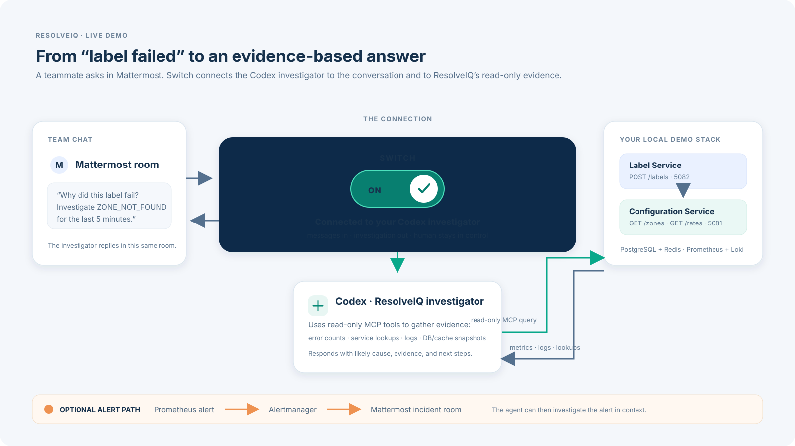

# ResolveIQ

ResolveIQ is a small .NET 10 fulfillment demo with two separate services. LabelService simulates label creation. ConfigService resolves a shipping zone and matching package rate using PostgreSQL, with Redis caching. There are no carrier integrations and no real label document.

## Demo flow



In this demo, Mattermost is the team chat, Switch connects the chat to the Codex investigator, and the investigator uses read-only MCP tools to examine ResolveIQ. The bottom alert path is optional; an alert posted to the room can prompt the same investigator to look into it.

## API endpoints

| Service | Endpoint | Behavior |
|---|---|---|
| ConfigService | `GET /zones` | Matches service type, origin/destination postcodes and countries. Returns `ZONE_NOT_FOUND` when there is no match. |
| ConfigService | `GET /rates` | Matches service type, zone, weight and parcel dimensions. Returns `ZONE_RATE_NOT_FOUND` if that zone/service has no rate records; returns `RATE_NOT_FOUND` if rates exist but none fit the parcel. |
| LabelService | `POST /labels` | Validates the shipment, calls `/zones`, then `/rates`, and returns HTTP 200 with a simulated label reference. Internal errors are mapped to consumer-facing errors. |

Each ConfigService lookup checks Redis first, reads PostgreSQL on a miss, and caches the result for 5 minutes. Redis read/write failures fall back to PostgreSQL. Validation errors return HTTP 400 with field names and messages. Zone/rate misses return HTTP 404 from ConfigService and are mapped to HTTP 422 by LabelService.

Swagger: `http://localhost:5081/swagger` and `http://localhost:5082/swagger`.

## Run locally

Requires Docker Desktop or OrbStack with Docker Compose. No .NET SDK, Rider, Switch account, or Mattermost account is needed to run the core demo.

```bash
docker compose up --build -d
```

On first startup, Compose downloads the required images, starts PostgreSQL, Redis, the two APIs, and the observability stack. ConfigService creates and seeds the demo database automatically. Give the containers a minute to become healthy, then open the Swagger pages below. To stop while preserving the demo data, run `docker compose down`. To reset the database and observability data for a clean run, run `docker compose down -v` and then start again.

- LabelService: `http://localhost:5082`
- ConfigService: `http://localhost:5081`
- PostgreSQL: `localhost:5432` (`resolveiq` / `resolveiq_dev`, local demo only)
- Redis: `localhost:6379`, no password for this local demo
- Grafana: `http://localhost:3000` (`admin` / `resolveiq_grafana_dev` by default)
- Prometheus: `http://localhost:9090`
- Loki: `http://localhost:3100`

The ConfigService creates and seeds package zones/rates idempotently. Redis is seeded with sample keys, then receives actual lookup cache entries when endpoints are called. Lookup keys remain visible for five minutes after use. `docker compose down` preserves data; `docker compose down -v` deletes local volumes.

For Rider, run ConfigService first with `ConnectionStrings__ConfigurationDatabase=Host=localhost;Port=5432;Database=resolveiq;Username=resolveiq;Password=resolveiq_dev` and `Redis__Configuration=localhost:6379`. Run LabelService with `ConfigurationService__BaseUrl=http://localhost:5081/`.

## Try it

Simulate successful label creation:

```bash
curl -i http://localhost:5082/labels \
  -H 'Content-Type: application/json' \
  -d '{"carrierServiceType":"GROUND","originPostcode":"94105","destinationPostcode":"10001","originCountry":"US","destinationCountry":"US","weight":2.5,"length":30,"height":20,"width":20}'
```

The seeded sample resolves to `US-WEST-TO-NORTHEAST`. Change the destination to `30301` to get a zone error. Use a length above `100` with the seeded Northeast zone to get a rate-dimension error. Set `carrierServiceType` to `ECONOMY` with the original addresses to demonstrate a zone that has no rate configured for that service.

Run a small mixed load (successful requests, missing-zone requests, and invalid parcels):

```bash
bash scripts/demo-load-test.sh 90 30
```

## Observability and Switch

Services export HTTP metrics, structured logs, and traces via OpenTelemetry. ConfigService records zone/rate lookup failure counters; both services log errors with trace correlation. The MCP investigation tool `InvestigateObservedErrors` counts a supported error code or HTTP status in Prometheus, then searches both services' Loki logs in the requested window. Configure the stdio MCP server on the Switch agent's Codex provider as described in [`docs/SWITCH_AGENT.md`](docs/SWITCH_AGENT.md).

### Reproduce the Switch chat workflow

The Docker Compose command above runs the ResolveIQ services and observability stack. To reproduce the chat workflow, a reviewer separately installs Switch Console, runs its local server (which includes a local Mattermost chat), and connects their own Codex provider. They do not need your account or your private local Mattermost room. For the MCP tool server, install the .NET 10 SDK, then follow [`docs/SWITCH_AGENT.md`](docs/SWITCH_AGENT.md) and replace its sample project path with the clone's path. Create a Codex-backed Switch agent named `resolveiq-investigator` and paste in the reusable [`agent instructions`](docs/resolveiq-investigator-prompt.md). Each reviewer configures their own agent and room; model credentials and chat history are never shipped in this repository.

Try this message in the room after generating a failed label request:

> @resolveiq-investigator Investigate `ZONE_NOT_FOUND` over the last 5 minutes. Count matching errors, search both services' logs, correlate the evidence, and explain the likely cause and next steps.

Prometheus evaluates an HTTP 4xx alert above 10 requests/second over 10 seconds and an HTTP 5xx alert above 1 request/second over 10 seconds, alongside infrastructure availability rules. To send alerts to Mattermost, create a Mattermost incoming webhook for `resolveiq-incidents`, save its secret URL only in the gitignored `secrets/mattermost-webhook` file, then start the optional Alertmanager profile:

```bash
docker compose --profile alerts up --build -d
```

For the endpoint walkthrough, sample error cases, and full demo sequence, see [`docs/DEMO_GUIDE.md`](docs/DEMO_GUIDE.md).

### Sharing or submitting the project

Share a Git repository containing the application source, Dockerfiles, Compose file, database/Redis seed scripts, observability configuration, and documentation. Do not include `.env`, `secrets/`, build output, or machine-specific IDE/cache folders. The core services run with the single Compose command above. Reproducing the chat workflow requires the reviewer to connect their own Switch Console and Codex provider; an incoming webhook is needed only to reproduce automatic alert notifications.

This is a local synthetic demo. Do not reuse the development credentials outside this project.
