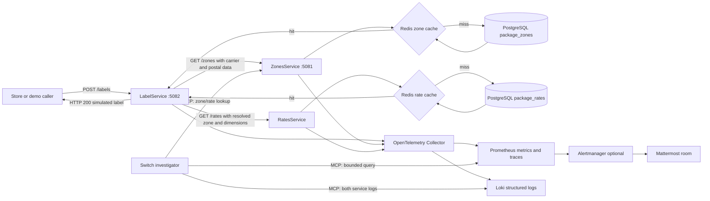

# ResolveIQ demo guide

## Request flow



## The only business API endpoints

| Service | Endpoint | Logic and failure responses |
|---|---|---|
| ConfigService | `GET /zones` | Requires `carrierServiceType`, `originPostcode`, `destinationPostcode`, `originCountry`, and `destinationCountry`. Checks Redis, then PostgreSQL on a miss. Returns the matched zone or `404 ZONE_NOT_FOUND`. |
| ConfigService | `GET /rates` | Requires `carrierServiceType`, `zone`, `weight`, `length`, `height`, and `width`. Checks Redis, then PostgreSQL on a miss. Returns the rate; returns `404 ZONE_RATE_NOT_FOUND` if no rates are configured for that zone/service, or `404 RATE_NOT_FOUND` if configured rates do not fit the parcel. |
| LabelService | `POST /labels` | Validates the shipment, calls `/zones`, then calls `/rates` with the returned zone. On success returns HTTP 200 and a simulated reference. It translates internal configuration errors to consumer-facing errors. |

Missing and invalid query/body values return HTTP 400 with field-specific validation messages. Redis caches successful and unsuccessful lookup results for 5 minutes; cache read/write failures fall back to PostgreSQL. LabelService does not call a carrier, save a label, or create a PDF.

Swagger is at `http://localhost:5081/swagger` and `http://localhost:5082/swagger`.

## Try the three demo cases

### Successful simulated label

```bash
curl -i http://localhost:5082/labels \
  -H 'Content-Type: application/json' \
  -d '{"carrierServiceType":"GROUND","originPostcode":"94105","destinationPostcode":"10001","originCountry":"US","destinationCountry":"US","weight":2.5,"length":30,"height":20,"width":20}'
```

The seeded match is zone `US-WEST-TO-NORTHEAST` and rate `12.75 USD`.

### Missing zone

Change destination postcode to `30301`. ConfigService logs and counts `ZONE_NOT_FOUND`; LabelService returns `DESTINATION_NOT_SERVICEABLE` with HTTP 422.

### No matching dimensions

Keep the valid addresses and set `length` to `150`. The zone exists, but its configured rates do not support that parcel length. LabelService returns `PARCEL_OUTSIDE_SERVICE_LIMITS` with HTTP 422.

### Zone exists but has no service rate

Use the same valid addresses with `carrierServiceType` set to `ECONOMY`. The zone lookup succeeds, but no Economy rate is seeded. LabelService returns `SERVICE_RATE_UNAVAILABLE` with HTTP 422.

Run a concurrent mix of successes, missing-zone errors, and invalid inputs:

```bash
bash scripts/demo-load-test.sh 90 30
```

The script prints counts of HTTP 200/400/422 responses: simulated label success, invalid input, and a missing-zone consumer error. Both 400 and 422 contribute to the HTTP 4xx alert.

## On-demand agent investigation

In the Switch room ask, for example:

> Investigate `ZONE_NOT_FOUND` over the last 5 minutes. Count matching errors in Prometheus, search LabelService and ConfigService logs, correlate the evidence, and explain the likely cause.

The `InvestigateObservedErrors` MCP tool uses a bounded error/status allowlist for Prometheus and searches both services in Loki. The structured failure logs include error code, postal/service context, and the OpenTelemetry trace ID; LabelService propagates the trace context to ConfigService. The agent can also use `GetCarrierQuote` to retry the same read-only zone-then-rate lookup with supplied parcel details.

## Alert notification

Prometheus has an HTTP 4xx rate rule that fires above 10 requests per second over 10 seconds and an HTTP 5xx rule that fires above 1 request per second over 10 seconds, plus Redis/PostgreSQL/collector availability rules. Alertmanager can post firing and resolved events to Mattermost and mention `@resolveiq-investigator`. This requires a Mattermost incoming webhook URL stored in the gitignored `secrets/mattermost-webhook` file. Start the alerting profile with:

```bash
docker compose --profile alerts up --build -d
```

Switch must be configured to respond to the investigator mention. The MCP server only reads metrics, logs, and configuration; it does not change zones/rates or restart infrastructure.
