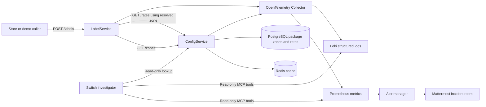

# ResolveIQ: AI-Assisted Fulfillment Operations

## Project summary

ResolveIQ is a .NET demo for investigating fulfillment configuration failures and operational errors across services. A simulated label request is routed through a separate configuration service, which resolves the shipping zone and package rate from PostgreSQL and uses Redis to cache repeated lookups. OpenTelemetry sends metrics and structured logs to Prometheus and Loki. A read-only MCP investigator can query those signals and explain likely causes.

The demo focuses on making cross-team failures understandable. A developer can see whether an address has no configured zone, whether a service has no configured rate, or whether the parcel dimensions exceed configured limits. The successful label response is simulated; there is no carrier integration or label file.

## Why it is useful

In a multi-service system, an error often originates in a configuration owned by another team. The request owner may see a generic failure without knowing which zone, service rate, or dimension rule caused it. ResolveIQ makes those failure reasons visible, preserves correlation IDs across service calls, and gives an investigator bounded access to metrics and logs.

## Architecture



## Services and API

### Fulfillment.ConfigService

`GET /zones` accepts `carrierServiceType`, `originPostcode`, `destinationPostcode`, `originCountry`, and `destinationCountry`. It checks the Redis cache first and queries PostgreSQL on a cache miss. A missing match returns `ZONE_NOT_FOUND`.

`GET /rates` accepts `carrierServiceType`, `zone`, `weight`, `length`, `height`, and `width`. It checks Redis first and queries PostgreSQL on a miss. It returns `ZONE_RATE_NOT_FOUND` when the service has no rates for the zone, and `RATE_NOT_FOUND` when rates exist but do not support the requested parcel.

The lookup and caching policy lives in separate `ZonesService` and `RatesService` classes, with SQL isolated in `PackageRepository`. Successful and unsuccessful lookup results are cached for 5 minutes. If Redis is unavailable, the services continue using PostgreSQL.

### Fulfillment.LabelService

`POST /labels` validates the shipment, requests a zone, requests the matching rate, and returns HTTP 200 with a simulated label reference. It translates internal configuration errors into consumer-facing errors and includes a correlation ID. It does not call a carrier, persist a label, or generate a PDF.

### Consumer error mapping

| Internal condition | ConfigService response | LabelService response |
|---|---|---|
| Missing or invalid fields | HTTP 400 `VALIDATION_ERROR`, with field-specific messages | HTTP 400 `INVALID_SHIPMENT_DETAILS`, with field-specific messages |
| No matching zone | HTTP 404 `ZONE_NOT_FOUND` | HTTP 422 `DESTINATION_NOT_SERVICEABLE` |
| Zone/service has no rate configuration | HTTP 404 `ZONE_RATE_NOT_FOUND` | HTTP 422 `SERVICE_RATE_UNAVAILABLE` |
| Configured rates do not fit the parcel | HTTP 404 `RATE_NOT_FOUND` | HTTP 422 `PARCEL_OUTSIDE_SERVICE_LIMITS` |
| ConfigService unavailable | — | HTTP 503 with a consumer-safe error |

## Observability and AI investigation

Both services export HTTP metrics, traces, and structured logs through the OpenTelemetry Collector. Failure logs include error codes and trace IDs; the label-to-configuration HTTP call propagates the same trace ID. Prometheus exposes HTTP status counts and bounded domain error counters. Loki stores the two services' logs.

The Switch MCP investigator has read-only tools to:

- Count a supported package error code or HTTP status in Prometheus.
- Search both service logs in Loki for the same error and time window.
- Correlate the zone/rate lookup using trace IDs.
- Perform a read-only zone-then-rate lookup using shipment details.
- Inspect limited Redis, PostgreSQL, and infrastructure metrics/snapshots.

The agent reports evidence and recommendations. It does not edit configuration, write to Redis, restart services, create tickets, or invoke carrier systems.

Prometheus includes HTTP 4xx and 5xx rate alerts plus service/Redis/PostgreSQL availability rules. Alertmanager can post alerts to the Mattermost incident room through an incoming webhook. The URL is stored locally in the gitignored `secrets/mattermost-webhook` file. If the local webhook URL uses `localhost`, use `host.docker.internal` as the host so the Alertmanager container can reach the Switch-hosted Mattermost service. See [Mattermost incoming webhooks](https://docs.mattermost.com/integrations-guide/incoming-webhooks).

The HTTP 4xx rule fires above 10 requests per second over 10 seconds. The HTTP 5xx rule fires above 1 request per second over 10 seconds and is marked critical.

## Demo setup

Start the local services:

```bash
docker compose up --build -d
```

Service links:

- LabelService Swagger: `http://localhost:5082/swagger`
- ConfigService Swagger: `http://localhost:5081/swagger`
- Grafana: `http://localhost:3000`
- Prometheus: `http://localhost:9090`
- Loki: `http://localhost:3100`

Generate a valid simulated label:

```bash
curl -i http://localhost:5082/labels \
  -H 'Content-Type: application/json' \
  -d '{"carrierServiceType":"GROUND","originPostcode":"94105","destinationPostcode":"10001","originCountry":"US","destinationCountry":"US","weight":2.5,"length":30,"height":20,"width":20}'
```

The seeded sample resolves to zone `US-WEST-TO-NORTHEAST`, rate `12.75 USD`.

Demo error cases:

1. **Missing zone:** use destination postcode `30301`; expected consumer response is HTTP 422 `DESTINATION_NOT_SERVICEABLE`.
2. **Zone without a service rate:** use `carrierServiceType=ECONOMY` with the original addresses; expected response is HTTP 422 `SERVICE_RATE_UNAVAILABLE`.
3. **Parcel outside rate limits:** set `length=150`; expected response is HTTP 422 `PARCEL_OUTSIDE_SERVICE_LIMITS`.
4. **Invalid parcel:** set a dimension to `-1`; expected response is HTTP 400 with a field-specific validation message.

Run the concurrent mixed workload:

```bash
bash scripts/demo-load-test.sh 600 60
```

It sends successful, missing-zone, and invalid requests concurrently and prints the resulting HTTP status counts. In a recent local run, 600 requests produced 200 responses in each category and caused the HTTP 4xx rate alert to fire in Prometheus.

## Grafana log query

In Grafana, open **Explore**, select the **Loki** data source, choose a recent time range, and run:

```logql
{service_name=~"Fulfillment.LabelService|Fulfillment.ConfigService"} |= "ZONE_NOT_FOUND"
```

To show all logs for both services, run:

```logql
{service_name=~"Fulfillment.LabelService|Fulfillment.ConfigService"}
```

## Known demo limits

- Package-zone data uses sample postcode prefixes, countries, and service types.
- Rate matching uses a simple minimum/maximum weight plus maximum dimensions.
- Label success is simulated; no carrier or PDF integration exists.
- Mattermost delivery requires an incoming webhook URL and a running `alerts` Compose profile.
- The system is for local demo use only; credentials and seed data are not production-ready.
